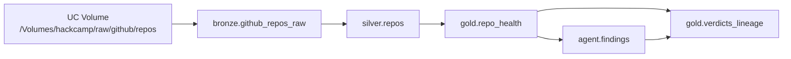

# Ticket #16 — Unity Catalog lineage (F11)

Verified November 7, 2026, profile `school`.

[Lineage capture run](https://dbc-a0a04386-0e40.cloud.databricks.com/jobs/914308422167152/runs/701435866713547?o=7474652966987564)

## Confirmed chain



| Edge | How captured |
| --- | --- |
| Volume → bronze | Lakeflow Auto Loader (`repo_health` pipeline). Open **bronze** Lineage tab (PATH / pipeline write). |
| bronze → silver | Pipeline materialized view — present in `system.access.table_lineage` |
| silver → gold | Pipeline materialized view — present in `system.access.table_lineage` |
| gold → findings | Agent MERGE now `LEFT JOIN`s `gold.repo_health` before write; `capture_lineage.sql` also stamps existing rows |
| gold + findings → `verdicts_lineage` | Demo view (1000 rows) — best single Catalog Explorer Lineage graph |

## Demo links (open **Lineage** → **See Lineage Graph**)

- [Volume `hackcamp.raw.github`](https://dbc-a0a04386-0e40.cloud.databricks.com/explore/data/volumes/hackcamp/raw/github)
- [bronze.github_repos_raw](https://dbc-a0a04386-0e40.cloud.databricks.com/explore/data/hackcamp/bronze/github_repos_raw)
- [silver.repos](https://dbc-a0a04386-0e40.cloud.databricks.com/explore/data/hackcamp/silver/repos)
- [gold.repo_health](https://dbc-a0a04386-0e40.cloud.databricks.com/explore/data/hackcamp/gold/repo_health)
- [agent.findings](https://dbc-a0a04386-0e40.cloud.databricks.com/explore/data/hackcamp/agent/findings)
- [gold.verdicts_lineage](https://dbc-a0a04386-0e40.cloud.databricks.com/explore/data/hackcamp/gold/verdicts_lineage) ← best single slide

Pitch tip: start on `verdicts_lineage`, expand upstream to gold/findings, then jump to bronze/silver for the pipeline segment.

## Re-run

```sh
cd databricks
databricks bundle deploy -t dev --profile school
databricks bundle run lineage_capture -t dev --profile school
```
