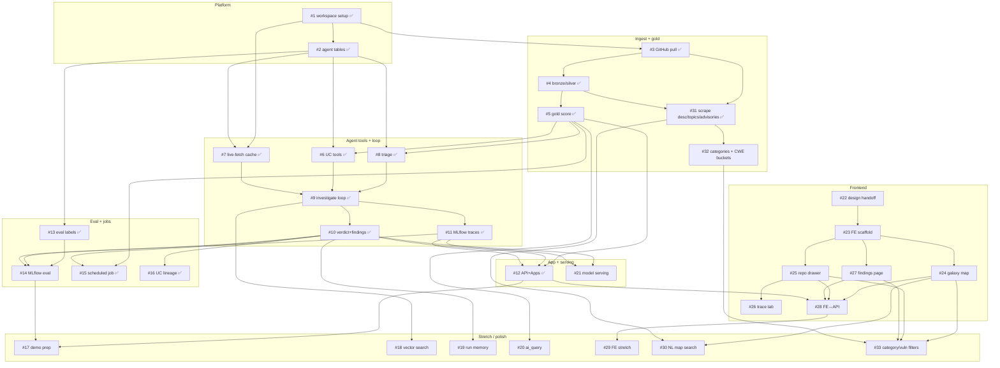

# Ticket dependency graph

Synced from GitHub issues on 2026-11-07 (`kathryntanardy/hackcamp_2026`).
✅ = closed on GitHub **or done in workspace**. Open: **17** (#14, #17–#22, #23–#30, #32–#33). Closed/done: **16** (#1–#13, #15–#16, #31).

**New:** **#30–#33** (F14 map search + F15 categories/CWEs).

Unblocked next (deps closed): **#14**, **#18**, **#19**, **#20**, **#21**, **#22**, **#32**.
Blocked: **#17** (needs #14), **#23–#29** (`blocked-by-design` / after #22), **#30** (needs #24+#31), **#33** (needs FE + #32).

